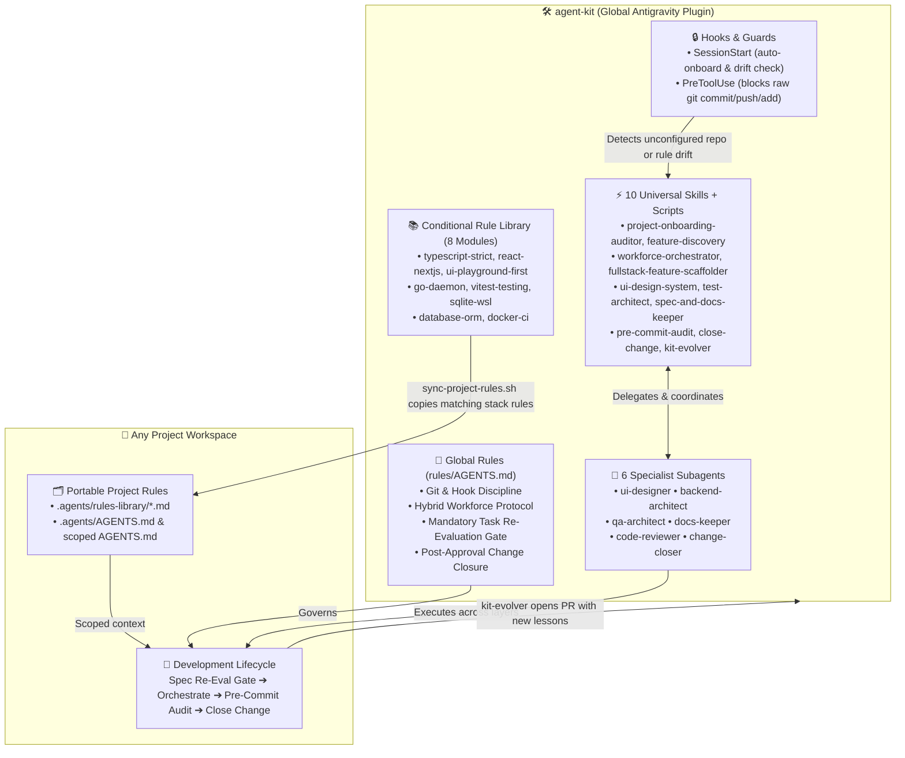

# 🛠️ Shared Agent & Skill Workforce (`agent-kit`)

A portable, cross-project Antigravity plugin providing a **6-Agent Specialist Workforce**, **10 Universal Skills with Executable Scripts**, **`SessionStart` & `PreToolUse` Hooks**, and an **8-Module Conditional Rule Library** across all workspaces.

- **Repository**: [https://github.com/bmartinsdev/agent-kit](https://github.com/bmartinsdev/agent-kit)
- **Global Plugin Mount**: `~/.gemini/config/plugins/agent-kit`
- **Optional Project Shortcut**: `~/p/agent-kit` (symlinked to `~/.gemini/config/plugins/agent-kit`)



---

## 🤖 Instructions for AI Agents (One-Prompt Setup & Updates)

> **If a user tells you: *"Setup https://github.com/bmartinsdev/agent-kit"* or *"Update `agent-kit` and onboard this project"*, follow these exact steps:**

### Step 1: Install or Update `agent-kit` Globally
- **Fresh Install (when `~/.gemini/config/plugins/agent-kit` does not exist)**:
  ```bash
  git clone https://github.com/bmartinsdev/agent-kit.git ~/.gemini/config/plugins/agent-kit
  ~/.gemini/config/plugins/agent-kit/scripts/install.sh
  ```
- **Update Existing Install**:
  ```bash
  ~/.gemini/config/plugins/agent-kit/scripts/sync-kit.sh --pull
  ```

### Step 2: Onboard the Active Workspace
1. Detect the current project's stack and sync matching conditional rule modules into `.agents/rules-library/`:
   ```bash
   ~/.gemini/config/plugins/agent-kit/skills/project-onboarding-auditor/scripts/detect-stack.sh
   ~/.gemini/config/plugins/agent-kit/skills/project-onboarding-auditor/scripts/sync-project-rules.sh
   ```
2. Read `~/.gemini/config/plugins/agent-kit/skills/project-onboarding-auditor/SKILL.md` and generate:
   - `.agents/AGENTS.md` (Project architecture map + repo-wide `@[...](./rules-library/<module>.md)` includes)
   - Directory-scoped `AGENTS.md` files (e.g. `src/app/AGENTS.md`, `src/daemon/AGENTS.md`) using **portable relative paths** (`@[...](../../.agents/rules-library/<module>.md)`).
   - **Never** hardcode user home paths (`/home/<user>/...`) inside repository markdown files.

---

## 🔄 Automatic New-Project & Update Detection (`SessionStart` Hook)

Whenever a new chat starts in any workspace, [`scripts/session-start.py`](./scripts/session-start.py) runs automatically via [`hooks.json`](./hooks.json):
1. **Unconfigured Project Detection**: If the active workspace does not have `.agents/AGENTS.md` yet, the agent automatically offers to run `project-onboarding-auditor`.
2. **Cross-Project Rule Drift Detection**: If a rule in `agent-kit/rules-library/` was updated while working in Project A, opening Project B detects that `.agents/rules-library/` has newer versions available and asks the user if they want to sync them.
3. **Remote GitHub Update Detection**: If `~/.gemini/config/plugins/agent-kit` is behind `origin/main`, the agent notifies the user and offers to pull the latest updates via `scripts/sync-kit.sh --pull`.
4. **Silent When Clean**: Outputs `{}` with zero token overhead when the project is already configured and up to date.

---

## 💬 Everyday Prompt Cheatsheet

| Goal | What to Say in Any Project | Skill / Agent Triggered |
| :--- | :--- | :--- |
| **Onboard a new or existing repo** | *"Onboard this project and wire up conditional rules"* | `project-onboarding-auditor` |
| **Brainstorm / spec a new feature** | *"Let's plan `<feature>` — scan existing capabilities first"* | `feature-discovery` + `spec-and-docs-keeper` |
| **Start a planned task or milestone** | *"Let's start Milestone 1"* *(auto-runs specialist audit + interview)* | `workforce-orchestrator` (Task Re-Evaluation Gate) |
| **Build or redesign UI screens** | *"Redesign `<screen>` using our Playground-first workflow"* | `ui-design-system` + `ui-designer` agent |
| **Build a full-stack feature/plugin** | *"Build `<feature>` end-to-end across backend and UI"* | `workforce-orchestrator` + `fullstack-feature-scaffolder` |
| **Fill test coverage gaps** | *"Scan for coverage gaps and add unit tests for `<module>`"* | `test-architect` + `qa-architect` agent |
| **Review changes before committing** | *"Run a pre-commit audit on my current changes"* | `pre-commit-audit` + `code-reviewer` agent |
| **Approve & commit completed work** | *"Approved — close the change and commit"* | `close-change` + `change-closer` agent |
| **Save a new rule/lesson to the kit** | *"Save this rule to `agent-kit` and open a PR"* | `kit-evolver` (`scripts/open-kit-pr.sh`) |
| **Check / pull `agent-kit` updates** | *"Check for `agent-kit` updates and sync rules"* | `scripts/sync-kit.sh` |

